# CharacterVerse AI

**Create, mix and animate original 3D characters** — a mobile-first creative studio for iOS (SwiftUI) and Android
(Jetpack Compose) with a Python/FastAPI backend that turns storyboards into real MP4 videos.

> Original IP only. No franchise characters, copied designs, paid packs, or assets with unclear commercial-use rights.
> Every built-in asset has a reviewed licence record and the backend enforces a licence gate.

<p align="center">
  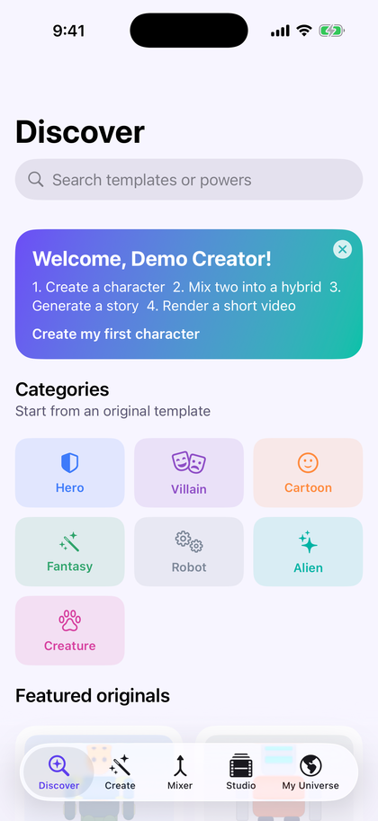
  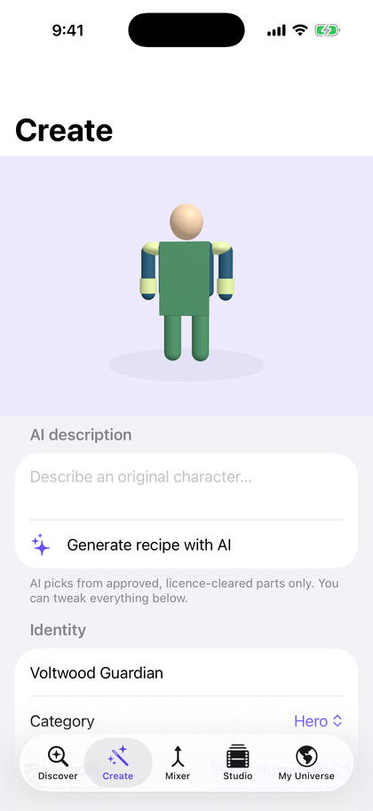
  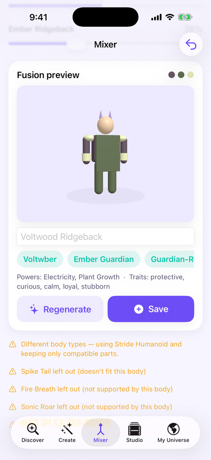
  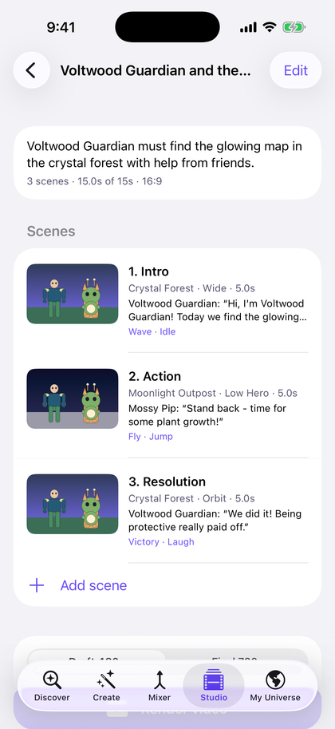
</p>

## What it does
| Pillar | Features |
|---|---|
| **Create** | 7 categories, 6 base bodies on 4 rig families, proportions, palette, one-per-slot outfit modules, powers, personality, fictional voices; *describe a character* → AI produces a validated recipe; 3D preview; versions, duplicate, archive, favourites, offline drafts |
| **Mix** | Pick 2–3 characters, choose appearance / powers / personality / voice, weight sliders, instant deterministic preview, compatibility warnings, AI name suggestions, undo, saved lineage |
| **Animate** | Prompt → structured story + storyboard (3–6 scenes), scene editor with environments, placement, rig-aware animation clips, camera & lighting presets, timeline, dialogue, SFX |
| **Share** | Server render queue with durable progress, cancel/retry, preview, export to the share sheet. Output: H.264/AAC MP4, 480p draft or 720p final, 16:9 or 9:16 |

**Rendered output** (frames from [`docs/media/demo-render.mp4`](docs/media/demo-render.mp4), produced by the backend from a generated storyboard):

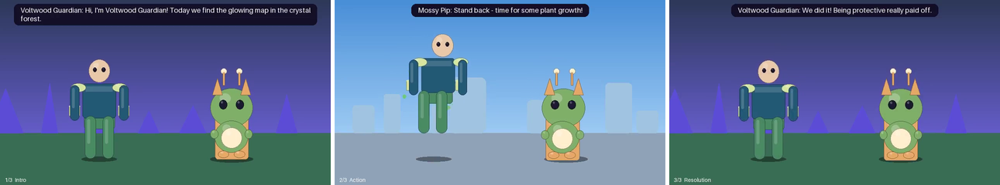

## Screenshots

### iOS (SwiftUI · iPhone 17 Pro simulator)
| Animation Studio | Render Queue | My Universe | Character | Story Creator |
|---|---|---|---|---|
| 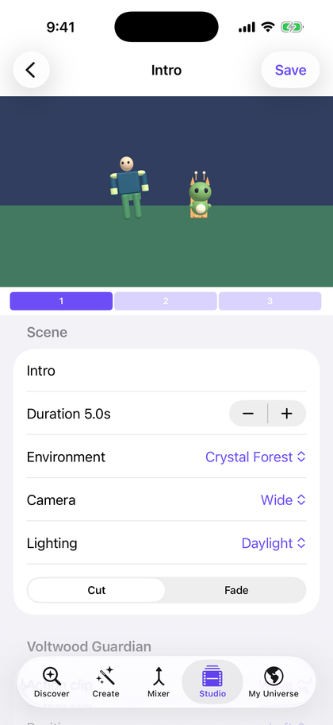 | 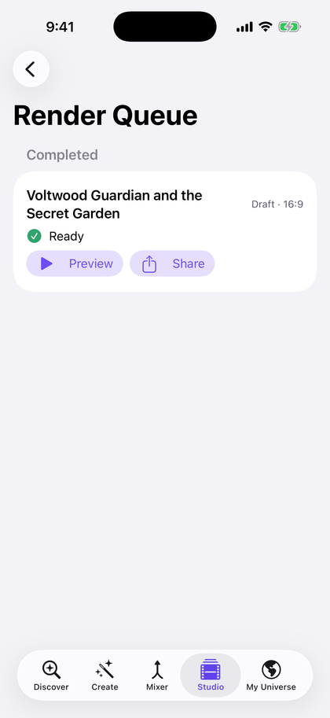 | 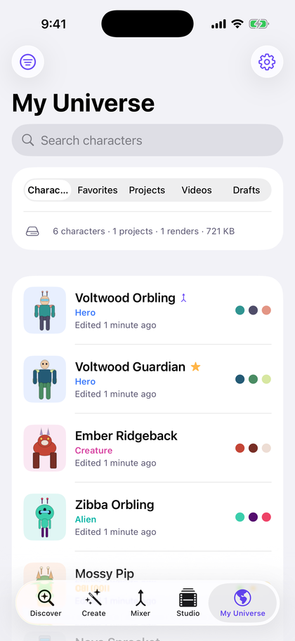 | 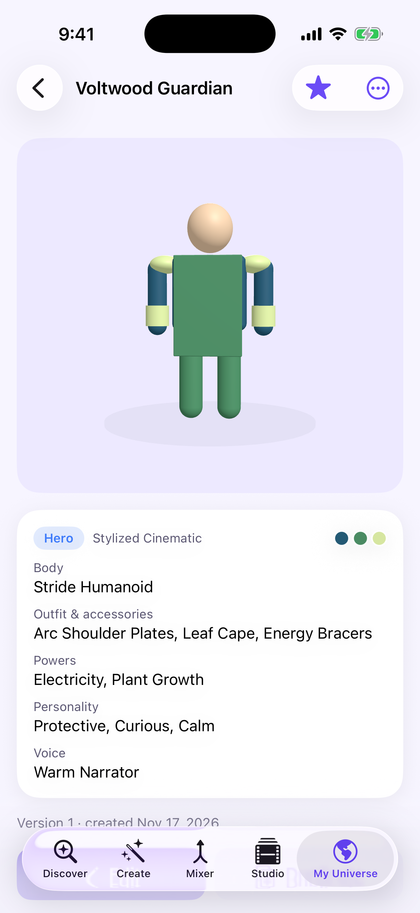 | 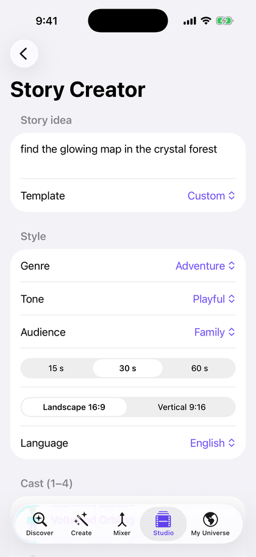 |

### Android (Jetpack Compose · Pixel emulator)
| Discover | Create | Mixer | Storyboard | Animation Studio |
|---|---|---|---|---|
| 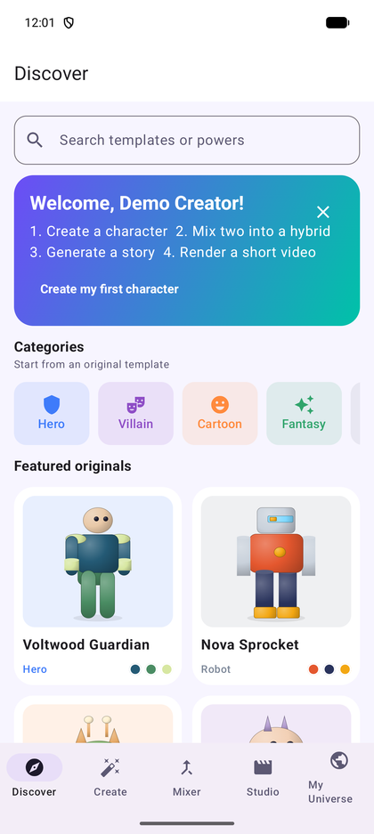 | 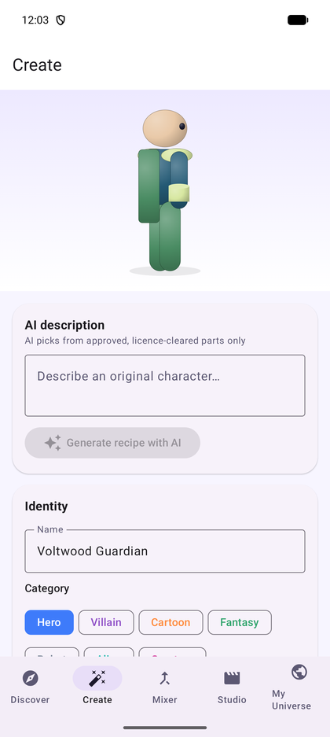 | 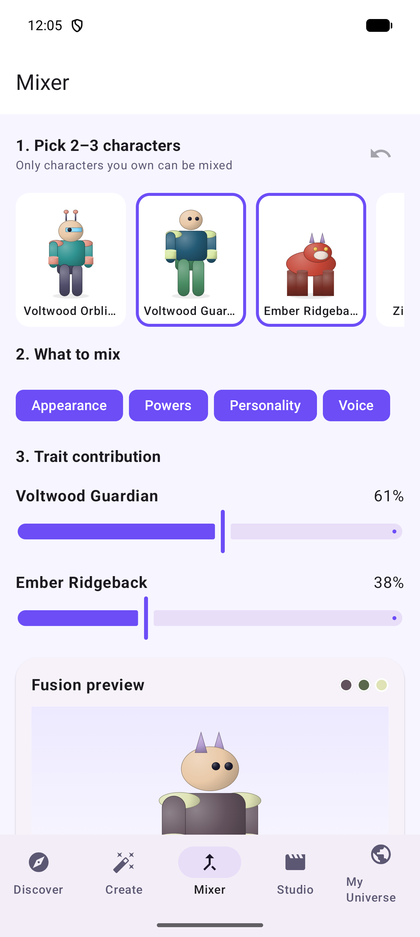 | 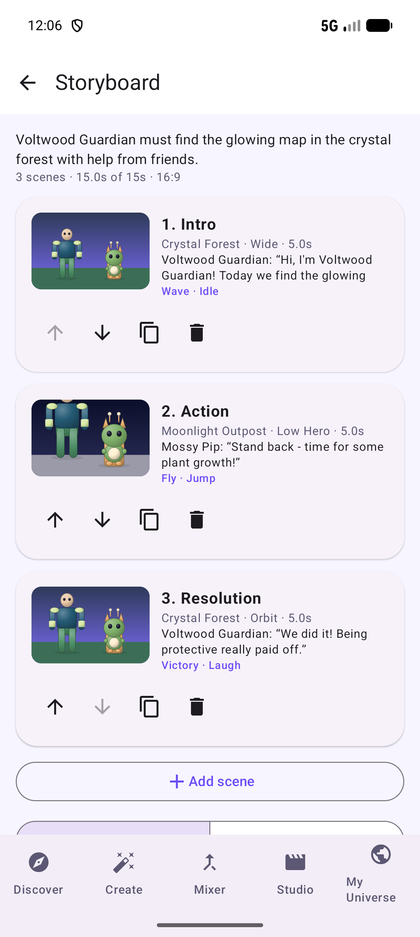 | 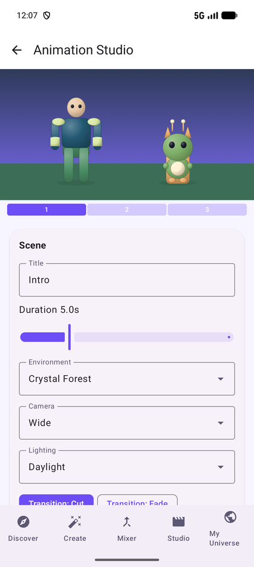 |

| Render Queue | My Universe | Character | Story Creator |
|---|---|---|---|
| 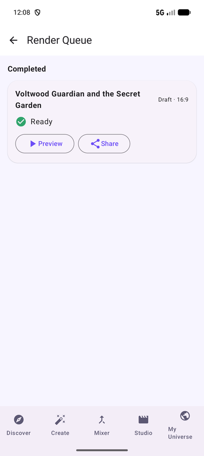 | 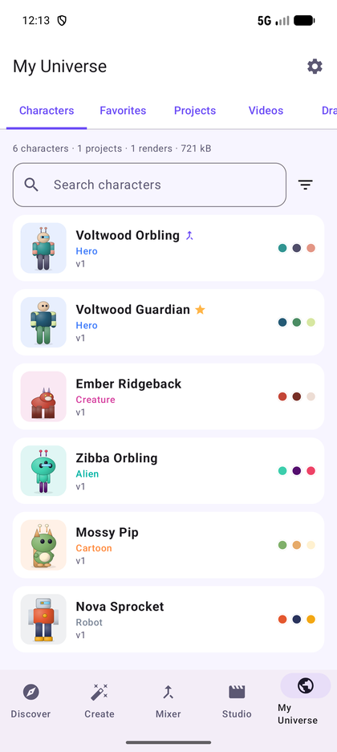 | 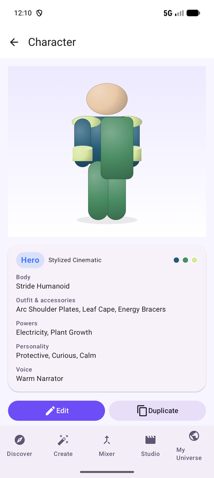 | 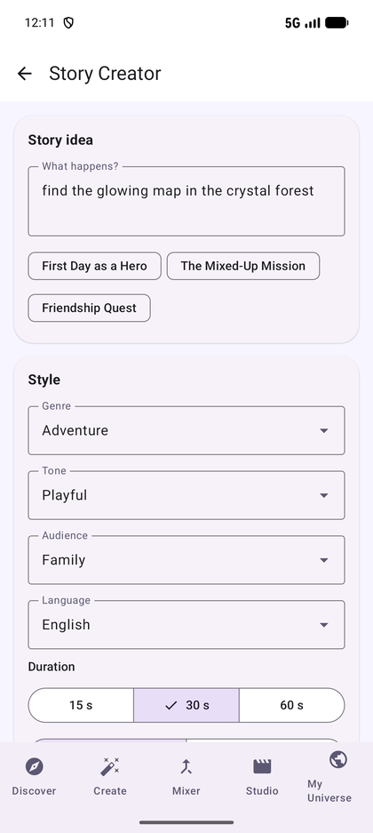 |

## Repository layout
```text
apps/ios        SwiftUI app (Swift 6 strict concurrency, SceneKit preview, SwiftData drafts, Keychain)
apps/android    Compose app (Hilt, Retrofit, Room, DataStore, Keystore, WorkManager, Media3)
backend         FastAPI modular monolith, render worker, Alembic migrations, 153 tests
shared          OpenAPI, error codes, JSON schemas, asset manifests, design tokens, golden fixtures
infrastructure  Dockerfiles (API, Blender worker), local env, deployment notes
docs            Architecture, API contracts, licences, security & privacy, status, ADRs, screenshots
requirements    IMPLEMENTATION_PLAN.md (product spec)
```

## Quick start
### Backend
```bash
cd backend
python3 -m venv .venv && .venv/bin/pip install -r requirements-dev.txt
.venv/bin/pytest                                   # 153 tests incl. a real MP4 render
.venv/bin/python -m scripts.seed_demo --render     # demo account, characters, project, rendered video
.venv/bin/uvicorn --factory app.main:app_factory --host 0.0.0.0 --port 8000   # docs at /docs
```
Full stack with PostgreSQL + Redis + RQ worker: `docker compose up --build`.

### iOS
```bash
cd apps/ios && brew install xcodegen && xcodegen generate
open CharacterVerse.xcodeproj           # run on a simulator; backend at http://localhost:8000
xcodebuild test -project CharacterVerse.xcodeproj -scheme CharacterVerse -destination 'platform=iOS Simulator,name=iPhone 17 Pro'
```

### Android
```bash
cd apps/android
./gradlew testDebugUnitTest assembleDebug          # emulator default API: http://10.0.2.2:8000/
# or: adb reverse tcp:8000 tcp:8000 && ./gradlew installDebug -PapiBaseUrl=http://localhost:8000/
```
Debug builds accept `-cvDevSignIn demo -cvScreen mixer` (iOS launch args) or `--es cvDevSignIn demo --es cvScreen mixer`
(Android intent extras) to open a screen directly — used for the screenshots above.

## How the pieces fit
- **One recipe format, three implementations.** Recipe validation, the fusion resolver and procedural part assembly
  exist in Python, Swift and Kotlin and are pinned by the same golden fixtures, so a character or fusion looks the same
  everywhere and clients can preview offline. See [ARCHITECTURE.md](docs/ARCHITECTURE.md).
- **AI returns data, never code.** Local deterministic adapters behind provider-neutral interfaces (no paid APIs);
  all output passes JSON-schema + registry validation ([ADR 0004](docs/ADR/0004-ai-provider-abstraction.md)).
- **Licence gate + moderation.** Unapproved assets are rejected everywhere; prompts, names and dialogue are checked
  with a fuzzy deny list and an imitation classifier, and decisions are audited.
- **Reliable rendering.** Idempotency keys, lease-based claims, bounded retries, cancellation and crash recovery
  ([ADR 0003](docs/ADR/0003-blender-rendering-pipeline.md)).

## Docs
[Architecture](docs/ARCHITECTURE.md) · [API contracts](docs/API_CONTRACTS.md) ·
[Asset & model licences](docs/ASSET_AND_MODEL_LICENSES.md) · [Security & privacy](docs/SECURITY_AND_PRIVACY.md) ·
[Implementation status](docs/IMPLEMENTATION_STATUS.md) · [ADRs](docs/ADR) · [Product spec](requirements/IMPLEMENTATION_PLAN.md)
